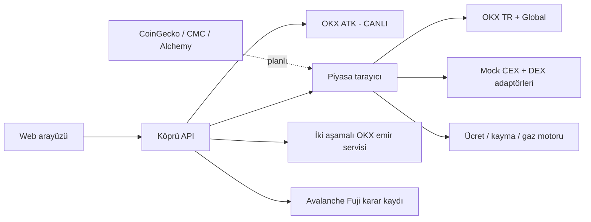

# KÖPRÜ — Agentic CEX/DEX Arbitraj Gözlemcisi

## 1. Ürün hedefi

Köprü; aynı varlığın farklı CEX ve DEX’lerdeki fiyatını ortak para birimine çevirir, işlem ücreti, kayma, gaz ve veri tazeliğini hesaba katar, uygulanabilir görünen rotayı açıklar. İlk güvenilir veri omurgası OKX TR ve OKX Global’dir. Diğer piyasalar önce açıkça etiketli mock adaptörlerle sisteme girer, sonra tek tek canlı adaptörlere dönüştürülür.

Sistem üç katmana ayrılır:

1. **Gözlem:** Piyasaları tara ve veriyi normalize et.
2. **Karar:** Net maliyet sonrası fırsatı sırala ve riski açıkla.
3. **Eylem:** Yalnızca iki canlı ayak, yeterli bakiye/envanter ve kullanıcı onayı varsa emir üret.

Bugünkü sürüm ilk iki katmanın çalışan prototipidir. Gerçek çoklu-borsa yürütmesi kapsamda değildir.

## 2. Etiket sözleşmesi

| Etiket | Anlamı | Emir üretir mi? |
|---|---|---|
| `LIVE / CANLI` | Kaynaktan o anda alınan gerçek veri | Tek başına hayır; diğer güvenlik koşulları gerekir |
| `MOCK` | Canlı referanstan deterministik biçimde üretilen simülasyon | Hayır, zorunlu olarak kapalı |
| `CONFIG_REQUIRED / YAPILANDIRMA GEREKLİ` | Adaptör planlı fakat anahtar/entegrasyon tamamlanmamış | Hayır |

Arayüz, API ve testler bu sözleşmeyi aynı şekilde kullanır. Mock veri asla canlıymış gibi gösterilemez.

## 3. Mevcut kapsam — 17 Ekim 2026

### Canlı

- OKX Global: BTC-USDT
- OKX TR: BTC-TRY ve USDT-TRY
- Kaynak: OKX Agent Trade Kit

### Mock CEX

- Binance, Coinbase, Kraken, Bybit, KuCoin, Gate.io, MEXC

### Mock DEX

- Uniswap / Ethereum
- PancakeSwap / BNB Chain
- Curve / Ethereum
- Trader Joe / Avalanche
- Pangolin / Avalanche
- SushiSwap / Arbitrum
- Balancer / Ethereum

Bu liste “tüm ekosistem” yaklaşımını gösterecek temsilî katalogdur. Yeni adaptörler aynı veri sözleşmesiyle eklenebilir.

### Planlı veri sağlayıcıları

- CoinGecko: geniş piyasa ve on-chain fiyat doğrulama
- CoinMarketCap: piyasa çiftleri, hacim ve likidite doğrulama
- Alchemy Prices: token adresi ve DEX fiyat doğrulama

## 4. Hesap modeli

Her piyasa BTC başına TL değerine normalize edilir.

```text
referans BTC/TL = OKX Global BTC-USDT × OKX TR USDT-TRY
işlem oranı = ücret yüzdesi + tahmini kayma yüzdesi
efektif alış = ham fiyat × (1 + işlem oranı) + ağ maliyeti / BTC miktarı
efektif satış = ham fiyat × (1 - işlem oranı) - ağ maliyeti / BTC miktarı
net sonuç = satış geliri - alış maliyeti
```

Mock fiyatlar rastgele değildir; canlı OKX referansına kaynak başına sabit baz-puan sapması uygulanır. Bu, test ve demoları tekrar üretilebilir yapar. Bu sayılar gerçek fırsat değildir.

## 5. Güvenlik politikası

- Mock ayak içeren rota: `simulationOnly=true`, `executable=false`.
- İki canlı ayak bile bulunsa bakiye, envanter, çekim/yatırma durumu ve ağ kesinliği kontrol edilmeden yürütme yok.
- OKX emri varsayılan kapalıdır.
- Gerçek OKX emri için kısa ömürlü önizleme ve eylem anında açık kullanıcı onayı gerekir.
- API anahtarları yalnız sunucu ortamında tutulur.
- Tek işlem üst limiti korunur.
- Fiyat tazeliği aşılırsa karar üretilemez.

## 6. Mimari



## 7. Tamamlanan işler

- [x] Deterministik OKX TR AL / BEKLE karar motoru
- [x] OKX Agent Trade Kit canlı ticker bağlantısı
- [x] Global BTC fiyatını TL’ye normalize etme
- [x] Veri tazeliği ve politika kontrolleri
- [x] İki aşamalı, varsayılan kapalı OKX spot emir akışı
- [x] 16 piyasalık canlı + mock tarayıcı
- [x] CEX/DEX ücret, kayma ve ağ maliyeti modeli
- [x] API ve arayüzde canlı/mock/yapılandırma etiketi
- [x] Mock rotalar için yürütme engeli
- [x] Fuji cüzdanı oluşturma, kontrat derleme ve dağıtım betikleri
- [x] Otomatik test paketi ve güvenlik başlıkları

## 8. Sıradaki geliştirme adımları

Her adım başlamadan önce `npm run check`, bittikten sonra birim + API + tarayıcı doğrulaması yapılır.

### Faz A — Canlı veri kapsamı

- [ ] CoinGecko API anahtarı ve adaptörü
- [ ] CoinMarketCap API anahtarı ve adaptörü
- [ ] Alchemy API anahtarı, ağ ve token adresi yapılandırması
- [ ] İlk ek canlı CEX adaptörü; read-only anahtar veya açık ticker
- [ ] Avalanche üzerinde Trader Joe/Pangolin canlı quote adaptörü
- [ ] Her canlı kaynağa gecikme, likidite ve hata devre kesicisi

### Faz B — Gerçekçi fırsat doğrulama

- [ ] Alış/satış order-book derinliğinden bütçeye özel VWAP
- [ ] Transfer, çekim, yatırma, ağ ve köprü ücretleri
- [ ] CEX/DEX sembol ve token adresi eşleme kayıt defteri
- [ ] Stablecoin depeg ve TRY dönüşüm riski
- [ ] Aynı anda alınmış snapshot ve maksimum saat sapması
- [ ] Yanlış pozitifleri engelleyen minimum likidite eşiği

### Faz C — Agentic yürütme, önce paper trading

- [ ] Paper trading cüzdanları ve sanal envanter
- [ ] Agent durum makinesi: keşfet → doğrula → risk kontrolü → onay → simüle et → kaydet
- [ ] Başarısız ayakta telafi ve açık pozisyon koruması
- [ ] Günlük zarar, işlem adedi ve varlık limiti
- [ ] İnsan onaylı iki canlı ayak demo akışı

### Faz D — Avalanche

- [ ] Fuji faucet ile test AVAX
- [ ] `DecisionLedger` kontratını Fuji’ye dağıtma
- [ ] Kontrat adresini `.env.local` içine ekleme
- [ ] Gerçek işlem kimliği ve explorer bağlantısını arayüzde doğrulama

### Faz E — Ürünleştirme

- [ ] Kimlik doğrulama ve kullanıcıya özel şifreli anahtar kasası
- [ ] Kalıcı veri tabanı, fırsat geçmişi ve denetim kaydı
- [ ] Bildirimler ve zamanlanmış taramalar
- [ ] Gözlemlenebilirlik, oran sınırlama ve alarm sistemi
- [ ] Bağımsız güvenlik incelemesi

## 9. Kabul kriterleri

Bir kaynak ancak şu şartlarda CANLI olabilir:

- Gerçek uç noktadan son fiyat veya uygulanabilir quote alınması
- Zaman damgası ve veri yaşı kontrolü
- Birim dönüşümü ve sembol/token eşlemesinin doğrulanması
- Ücret ve kayma modelinin kaynağa özel olması
- Hata halinde mock’a sessizce düşmemesi; açık hata vermesi
- Otomatik test ve tarayıcıda görünür canlı etiketi

Gerçek arbitraj yürütmesi ancak iki ayağın da canlı olması, bakiyelerin hazır olması, transfer gerekmemesi veya önceden finanse edilmiş envanter bulunması, net sonucun güvenlik tamponunu aşması ve kullanıcının eylem anında onay vermesiyle açılabilir.
