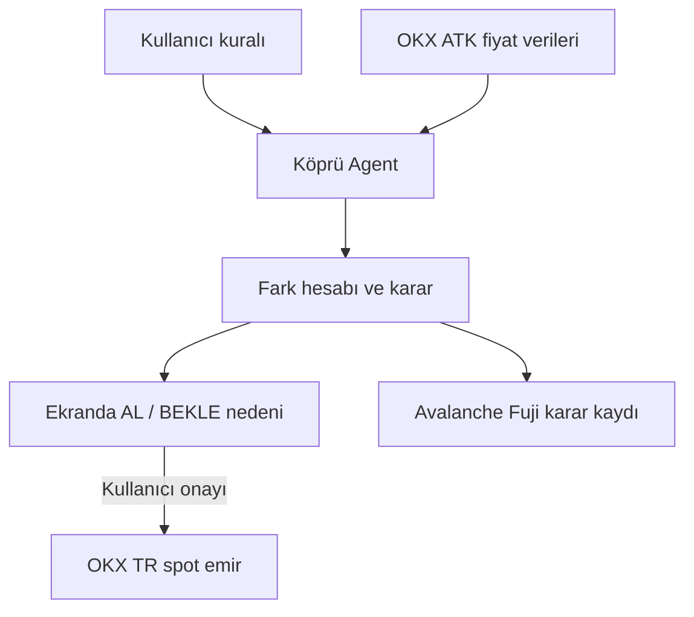

# KÖPRÜ — Global Fiyat ile OKX TR Fiyatını Karşılaştıran Alım Karar Agent'ı

> **Hackathon amacı:** OKX TR kullanıcısının, BTC almak için belirlediği bütçeyi yönetmesine yardım etmek. Agent global fiyatı, TRY/USDT kurunu ve OKX TR'deki BTC-TRY fiyatını karşılaştırır; kullanıcı kuralına göre **al**, **bekle** veya **işlem yapma** kararı verir ve nedenini açıklar.
>
> Bu proje bir “kesin kâr” veya “arbitraj robotu” değildir. Kullanıcıya aynı varlığın TRY karşılığını şeffaf biçimde gösterir ve kendi kuralları içinde işlem planını uygular.

---

## 1. Günlük hayatta bu proje ne yapıyor?

### Telefon fiyatı örneği

Bir telefonun yurt dışı fiyatı 1.000 dolar olsun. Doları 40 TL kabul edersek telefonun kaba karşılığı **40.000 TL** olur.

- Türkiye mağazasında telefon 40.300 TL ise: fark küçük olabilir; vergiler ve mağaza maliyeti vardır.
- Telefon 43.000 TL ise: Türkiye fiyatı karşılaştırmaya göre daha pahalı görünür.

**Köprü**, Bitcoin için aynı hesabı yapar:

1. Globalde Bitcoin kaç USDT?
2. OKX TR'de bir USDT kaç TL?
3. O zaman Bitcoin'in hesaplanan TL karşılığı kaç?
4. OKX TR'de Bitcoin gerçekten kaç TL?
5. Kullanıcının “bu kadar pahalıyken alma” kuralı ne diyor?

Agent bu iki piyasa arasındaki bilgiyi birbirine bağladığı için adı **Köprü**.

### Market örneği

Bir markette domatesin kilosu 80 TL, diğerinde 92 TL olabilir. Sadece etikete bakıp “92 TL olan kesin kötü” diyemeyiz: kalite, yol, stok ve indirim farkı olabilir.

Köprü de “Türkiye fiyatı %2 pahalı, kesin zarar” demez. Şunu der:

> “Karşılaştırma fiyatı 4.000.000 TL. OKX TR satış fiyatı 4.080.000 TL. Fark %2. Kullanıcının izin verdiği üst fark %0,8 olduğu için bugün alım planı bekletildi.”

Bu yaklaşım hem dürüst hem de kullanıcı için anlaşılırdır.

---

## 2. Kullanıcı kim, sorunu ne?

### Hedef kullanıcı

OKX TR'de TL ile Bitcoin alan; global piyasa, dolar/USDT ve Türkiye fiyatını tek tek takip etmeyen kişi.

### Sorun

Kullanıcı sadece BTC-TRY fiyatına bakınca şu iki şeyi ayıramaz:

- Bitcoin dünyada mı yükseldi?
- Yoksa Türkiye'deki TRY fiyatı karşılaştırmaya göre mi daha yüksek?

Ayrıca kullanıcı her an ekran başında değildir. “Fiyat bana göre uygunsa al, değilse bekle” kuralını düzenli uygulamak ister.

### Çözüm

Kullanıcı yalnızca şunları belirler:

- Alım bütçem: örneğin 1.000 TL
- En fazla kabul ettiğim fark: örneğin %0,8
- İşlem iznim: önce sadece öneri / sonra otomatik işlem

Agent gerisini yürütür: veri alır, hesap yapar, kuralı uygular, sonucu açıklar.

---

## 3. Minimum çalışan ürün (MVP)

Bu hackathonda sadece aşağıdakileri bitireceğiz:

- **Tek varlık:** BTC
- **Tek karar:** AL veya BEKLE
- **Tek yerel piyasa:** OKX TR BTC-TRY ve USDT-TRY
- **Tek global karşılaştırma:** BTC-USDT
- **Tek kullanıcı politikası:** `Fark <= %0,8 ise en fazla 1.000 TL BTC al; değilse bekle.`
- Her kararda kullanıcıya sade neden gösterme
- Avalanche Fuji'de her kararın özeti için küçük bir kayıt

### İlk sürümden kesinlikle çıkarılanlar

- Kaldıraç, vadeli işlem, kredi, bot, Earn
- Haber analizi ve sosyal medya sinyali
- Çok sayıda coin
- Borsalar arası para taşıma
- “Garantili kâr” söylemi
- Global türev verisi: funding rate, open interest ve likidasyonlar

Bunlar projenin sonraki aşamasıdır. Başlangıçta tek işini kusursuz yapan agent daha yüksek puan getirir.

---

## 4. Kuralın arkasındaki basit hesap

### Girdiler

| Ad | Ne demek? | Örnek |
|---|---|---:|
| `globalBtcUsdt` | Globalde 1 BTC'nin USDT fiyatı | 100.000 USDT |
| `usdtTry` | OKX TR'de 1 USDT'nin TL fiyatı | 40 TL |
| `trBtcTryAsk` | OKX TR'de BTC almak için görülen en iyi fiyat | 4.080.000 TL |
| `maxPremiumPct` | Kullanıcının kabul ettiği en yüksek fark | %0,8 |
| `budgetTry` | Kullanıcının tek işlem bütçesi | 1.000 TL |

### Hesap

```text
hesaplanan TL karşılığı = global BTC-USDT × USDT-TRY
fark yüzdesi = (TR BTC alış fiyatı - hesaplanan TL karşılığı) / hesaplanan TL karşılığı × 100
```

Örnekte:

```text
100.000 × 40 = 4.000.000 TL
(4.080.000 - 4.000.000) / 4.000.000 × 100 = %2
```

Kullanıcının sınırı %0,8 ise sonuç: **BEKLE**.

### Çok önemli dürüstlük kuralı

Bu hesap “fiyat farkı” gösterir; kâr garantisi vermez. İşlem ücreti, anlık değişim ve alım satım arasındaki fark ayrıca hesaba katılmalıdır. Bu yüzden sonradan ekleyeceğimiz kontrol şudur:

```text
Toplam maliyet = TR alış fiyatı + tahmini ücret
```

---

## 5. Agent nasıl düşünüyor?

Agent, sırayla şu işi yapar. Bu zinciri sunumda aynen kullanabilirsin.

1. **Veriyi alır.** Global BTC-USDT, OKX TR BTC-TRY ve OKX TR USDT-TRY fiyatını ATK ile ister.
2. **Verinin yeni olup olmadığını kontrol eder.** Örneğin üç veriden biri eski veya boşsa işlem yapmaz.
3. **Karşılaştırma fiyatını hesaplar.** Global BTC fiyatını TL karşılığına çevirir.
4. **Kullanıcı kuralını okur.** “Fark %0,8 ve altındaysa, 1.000 TL'ye kadar al.”
5. **Karar verir.** AL, BEKLE veya VERİ HATASI.
6. **İşlemden önce kullanıcıya sonucu gösterir.** İlk demoda otomatik işlem yerine kullanıcının onay düğmesi olacak.
7. **Onay verilirse ATK ile spot emir gönderir.** Bu aşama erişim ve etkinlik kuralına göre açılır.
8. **Sonucu tekrar kontrol eder.** Emrin gerçekleşip gerçekleşmediğini ve ne kadar BTC alındığını okur.
9. **Avalanche Fuji'ye karar kaydını yazar.** Fiyatlar, sonuç ve zaman damgasının özeti kaydedilir.

Bu yüzden Köprü yalnızca “fiyat gösteren sayfa” değildir: **görür → hesaplar → kuralı uygular → eylem yapar → sonucu doğrular → kayıt bırakır.**

---

## 6. Jüri kriterlerine göre tasarım

| Jüri başlığı | Köprü'de göstereceğimiz kanıt |
|---|---|
| Agentic Design — %20 | Kullanıcının her adımı söylemesine gerek kalmadan agent veri alır, geçerlilik kontrolü yapar, hesaplar, karar verir ve sonucu denetler. |
| Technical Execution — %15 | Çalışan arayüz, ayrı karar motoru, ATK veri çağrısı, hata durumları ve Fuji kontratı. |
| Avalanche — %10 | Fuji C-Chain'e gerçekten dağıtılmış karar kaydı kontratı. Kontrat adresi ve explorer bağlantısı sunumda açılacak. Hızlı kayıt, kararın zaman damgasını görünür kılar. |
| OKX — %10 | ATK ile piyasa verisi; yetki varsa spot emir. Köprü ileride başka uygulamaların çağırabileceği bir “fiyat uygunluk kontrolü” hizmeti olabilir. |
| Yenilik ve değer — %25 | TRY ile alan kullanıcıya özel, global fiyatı TL karşılığıyla karşılaştıran açıklanabilir karar. |
| Demo ve sunum — %20 | Ekranda üç fiyat, hesap, karar ve Fuji kaydı tek akışta görünür. |

### Jürinin sorabileceği soru ve net cevap

**“Bu sadece fiyat alarmı değil mi?”**

Hayır. Alarm sadece “fiyat şu oldu” der. Köprü üç piyasayı karşılaştırır, verinin güncelliğini denetler, kullanıcının bütçe kuralını uygular, işlem planı üretir ve sonucu doğrular.

**“Fark varsa neden global piyasadan alıp satmıyorsunuz?”**

İlk ürün borsalar arası para taşımıyor. OKX TR kullanıcısının kendi hesabında, TL ile alım kararını daha şeffaf vermesine yardımcı oluyor. Para transferi, ağ gecikmesi ve ek riskleri sonraki aşamaya bırakıyoruz.

**“Bu kesin kazandırır mı?”**

Hayır. Ama kullanıcının kendi fiyat sınırına tutarlı biçimde uymasını sağlar ve kararın gerekçesini görünür kılar.

**“Avalanche burada neden var?”**

Kullanıcı veya denetleyen kişi, kararın hangi fiyatlarla ve ne zaman alındığını sonradan görebilir. Fuji üzerinde gerçek kayıtla, uygulama ekranı dışında bağımsız bir karar izi bırakıyoruz.

---

## 7. Teknik mimari, sade anlatım



- **Arayüz:** Kullanıcının bütçeyi ve kabul ettiği farkı girdiği basit ekran.
- **Karar motoru:** Fiyatlardan hesap yapan küçük JavaScript/TypeScript fonksiyonu. Bu bölüm LLM'e bırakılmayacak; hesap her seferinde aynı ve denetlenebilir olacak.
- **ATK bağlantısı:** Gerçek OKX verisini bu kısım alacak.
- **Avalanche kontratı:** Kararın özeti ve zamanı için küçük kayıt defteri.
- **LLM / agent:** Araç seçimini, açıklamayı ve hata durumlarını yönetir. Fakat sayısal hesap ve limit kontrolü kodla yapılır.

---

## 8. Geliştirme sırası

### Adım 1 — Karar motoru (17 Ekim 2026 tamamlandı)

- [x] Kapsam sabitlendi: BTC, üç fiyat, AL/BEKLE.
- [x] Hesap kuralı tanımlandı.
- [x] Örnek verilerle çalışan ilk karar fonksiyonu eklendi: `src/kopru.js`.
- [x] Karar motoru ayrıştırıldı: `src/decision.js`.
- [x] Birim senaryoları eklendi: uygun fiyat, pahalı fiyat, eski veri (`src/decision.test.js`).
- [ ] Birim senaryolarını Node.js bulunan ortamda çalıştır.

### Adım 2 — Gerçek piyasa verisi

- [x] ATK için istemci adaptör arayüzü eklendi: `createAtkMarketProvider`.
- [ ] ATK kurulumu ve OKX TR bağlantısını doğrula.
- [ ] BTC-USDT, BTC-TRY, USDT-TRY sorgularını ayrı ayrı çalıştır.
- [ ] Fiyat alanlarının ve zaman bilgisinin doğru geldiğini ekranda göster.
- [ ] Bağlantı veya veri hatasında agent'ın “işlem yok” demesini uygula.

### Adım 3 — Basit arayüz

- [x] Bütçe ve maksimum fark alanları.
- [x] “Piyasayı kontrol et” düğmesi (örnek veri ve açık piyasa prototipi).
- [x] Üç kaynak fiyatı, hesaplanan TL değeri, fark yüzdesi ve karar kartı.
- [x] “Neden?” bölümü: tek cümlelik açıklama.

### Adım 4 — Emir ve güvenlik

- [ ] İlk olarak emir göndermeden “işlem planı” ekranı.
- [ ] Kullanıcı onayı olmadan emir yok.
- [ ] Etkinlik hesabı ve kurallar uygunsa küçük gerçek spot emir.
- [ ] Emirden sonra gerçekleşen fiyat ve miktarı tekrar oku.

### Adım 5 — Avalanche

- [ ] Fuji cüzdanını ayarla.
- [ ] Sadece karar özeti kaydeden basit kontratı dağıt.
- [ ] Kontrat adresini ve bir işlem bağlantısını sunuma koy.
- [ ] Karar ekranında kayıt işlem kimliğini göster.

### Adım 6 — Sunum

- [ ] 2 dakikalık canlı demo akışı prova.
- [ ] Ağ kesilmesi için açıkça etiketli kayıt videosu veya örnek veri.
- [ ] GitHub repo, kurulum adımları ve gizli anahtarsız `.env.example`.

---

## 9. İlk çalışan karar motoru

`src/kopru.js` şimdilik örnek veriyi kullanıyor. Bu, projenin beyninin ilk sürümüdür. Bir sonraki adımda örnek verileri ATK'den gelen gerçek fiyatlarla değiştireceğiz.

Çalıştırma:

```bash
node src/kopru.js
```

Beklenen örnek sonuç:

```text
Karar: BEKLE
Neden: OKX TR BTC alış fiyatı, hesaplanan TL karşılığının %2.00 üzerinde. Kullanıcı limiti %0.80.
```

---

## 10. 90 saniyelik sunum metni

> Türkiye’de TL ile Bitcoin alan biri, fiyatın dünyada mı arttığını yoksa Türkiye tarafında göreceli olarak mı pahalı olduğunu hızlıca ayıramıyor. Köprü bu problemi çözüyor.
>
> Agent, OKX araçlarıyla global BTC-USDT fiyatını, OKX TR BTC-TRY ve USDT-TRY fiyatlarını alıyor. Bunlardan Bitcoin’in hesaplanan TL karşılığını çıkarıyor ve OKX TR fiyatıyla kıyaslıyor.
>
> Kullanıcı sadece bütçesini ve kabul ettiği en yüksek farkı belirliyor. Köprü verinin güncelliğini denetliyor, hesaplıyor ve kullanıcı kuralına göre alım planı ya da bekleme kararı veriyor. Burada örneğin fark %2, kullanıcı limiti %0,8 olduğu için agent işlem yapmıyor ve nedenini açıkça gösteriyor.
>
> Kararın özeti Avalanche Fuji’ye kaydediliyor. Böylece kararın hangi verilerle ve ne zaman verildiğini uygulama dışından da izleyebiliyoruz.
>
> Köprü kâr garantisi vermiyor. OKX TR kullanıcısına, kendi alım kurallarını daha şeffaf ve tutarlı uygulama imkânı veriyor.

---

## 11. Proje günlüğü

### 17 Ekim 2026 — Başlangıç

- Fikir seçildi: Köprü.
- MVP yalnızca BTC ve AL/BEKLE kararıyla sınırlandı.
- Jüri kriterleri ürün tasarımına bağlandı.
- İlk karar motoru eklendi.
- Karar motoru veri tazeliği kontrolü ve üç test senaryosuyla ayrıştırıldı.
- Örnek ve açık piyasa verisi akışları olan ilk arayüz eklendi.
- Fuji için karar özeti kontratı taslağı eklendi; henüz dağıtılmadı.
- Sonraki iş: ATK bağlantısını etkinlik erişimiyle doğrulamak, ardından Fuji dağıtımı.
